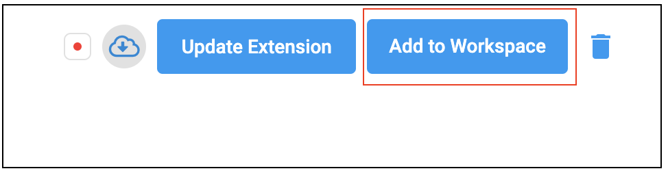
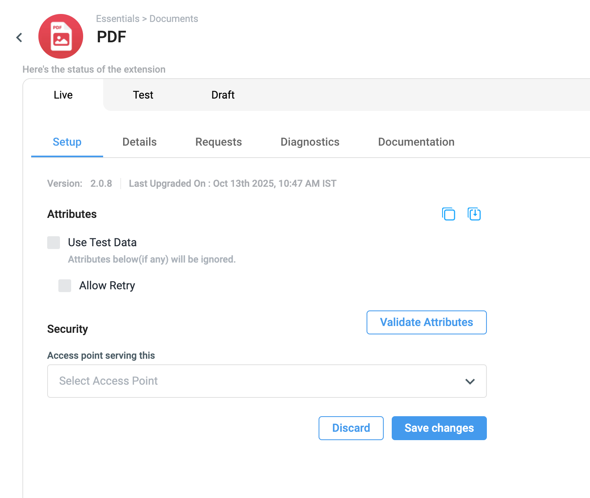
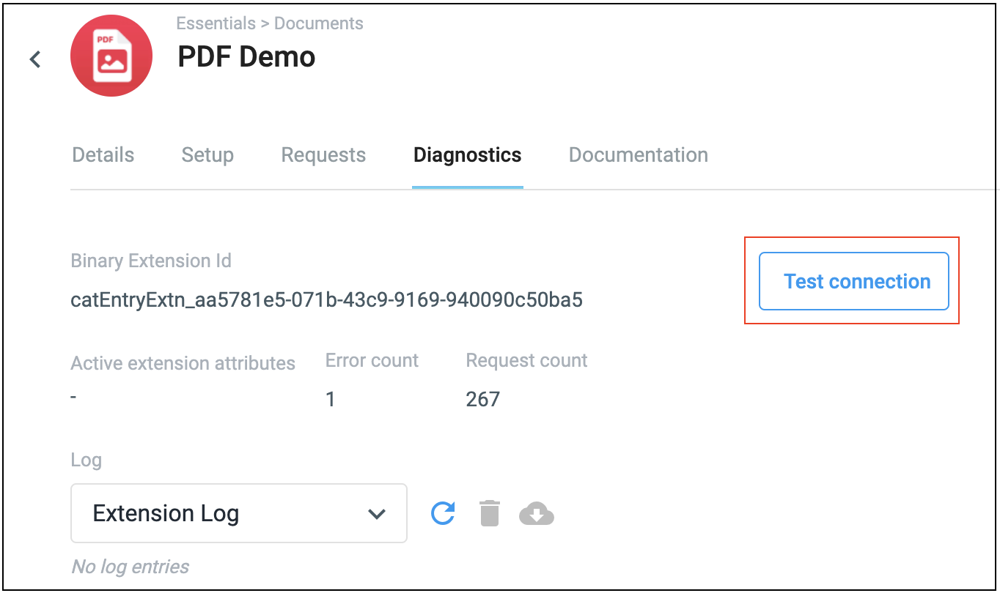

# Extension Configuration

## Overview

The PDF Extension requires minimal configuration to get started. Unlike extensions that require external service
authentication, the PDF Extension operates locally and only needs basic setup to control its processing behavior. The
primary configuration option is the **Allow Retry** flag, which determines how the extension handles validation and
error scenarios.

## Configuration Parameters

The PDF Extension has a simple configuration with one key parameter:

| Parameter   | Type    | Required | Description                                                                                                                                                                                                                       | Example Value    |
|-------------|---------|----------|-----------------------------------------------------------------------------------------------------------------------------------------------------------------------------------------------------------------------------------|------------------|
| Allow Retry | Boolean | No       | Controls whether enhanced validation mode is enabled. When enabled, the extension provides comprehensive input validation with user prompts. When disabled, the extension processes requests directly without validation prompts. | `true` (default) |

## Step-by-Step Setup

### 1. Add Extension to Workspace

1. Navigate to the **Catalog** section in your Krista workspace
2. Click on **Essentials Ecosystem**
3. Under the Essentials Ecosystem, click on **Documents**
4. Click on **Extensions**
5. Select **PDF Extension**
6. Click **Add to Workspace**

   
   *Figure 1: Add to Workspace button*

### 2. Upgrade to Latest Version

1. After adding the extension, you will be redirected to the extension page
2. Click **Upgrade** to install the latest version of the extension

   
   *Figure 2: Upgrade extension to latest version*

### 3. Configure Allow Retry Flag

1. Go to the extension **Setup** page
2. Locate the **Allow Retry** configuration option
3. Choose the appropriate setting based on your use case:
    - **Enabled (true)**: Use for interactive workflows where users provide input
    - **Disabled (false)**: Use for automated workflows without user interaction

### 4. Test Connection

1. On the Setup page, click **Diagnostics**
2. Click **Test Connection** to verify the extension is properly configured

   
   *Figure 3: Test connection to verify extension is working*

3. If the test is successful, you're ready to use the extension

## Allow Retry Flag Explained

The **Allow Retry** flag is a critical configuration that determines the extension's processing mode:

### When Allow Retry is Enabled (true)

**Use Case**: Interactive workflows with user input

**Behavior**:

- Comprehensive input validation before processing
- User prompts for invalid or missing data
- Detailed error messages with resolution guidance
- Validation errors allow users to correct input and retry
- Suitable for conversational AI interactions

**Example Scenario**:

```
User: "Convert this Excel file to PDF"
System: *validates file format*
System: "The file format is invalid. Please provide a valid Excel file (.xlsx or .xls)"
User: *provides correct file*
System: *processes successfully*
```

### When Allow Retry is Disabled (false)

**Use Case**: Automated workflows and batch processing

**Behavior**:

- Direct processing without validation prompts
- No user interaction required
- Errors return immediately with system error messages
- Faster processing for valid inputs
- Suitable for automation and API integrations

**Example Scenario**:

```
Automation: *sends Excel file for conversion*
System: *processes directly without validation prompts*
System: *returns PDF or error immediately*
```

## Processing Modes Comparison

| Feature              | Enhanced Validation Mode<br/>(Allow Retry = true) | Direct Processing Mode<br/>(Allow Retry = false) |
|----------------------|---------------------------------------------------|--------------------------------------------------|
| **Input Validation** | Comprehensive validation with user prompts        | No validation prompts                            |
| **Error Handling**   | INPUT_ERROR with retry options                    | SYSTEM_ERROR without retry                       |
| **User Interaction** | Required for invalid inputs                       | Not required                                     |
| **Processing Speed** | Slower (includes validation)                      | Faster (direct processing)                       |
| **Best For**         | Interactive workflows, conversational AI          | Automation, batch processing, APIs               |
| **Error Messages**   | Detailed with resolution steps                    | Basic error information                          |

## Security Considerations

### File Processing Security

1. **File Size Limits**: The extension enforces a maximum file size of 25MB for image files to prevent memory issues
2. **File Type Validation**: Only supported file formats are processed (when Allow Retry is enabled)
3. **Local Processing**: All file processing occurs locally within the Krista environment
4. **No External Services**: The extension does not send data to external services

### Best Practices

1. **Enable Allow Retry for User-Facing Workflows**: Provides better user experience with clear error messages
2. **Disable Allow Retry for Automation**: Reduces processing overhead for trusted automated inputs
3. **Validate File Sources**: Ensure files come from trusted sources before processing
4. **Monitor File Sizes**: Large files may impact performance; consider splitting large documents

## Troubleshooting

### Common Configuration Issues

#### Issue: Test Connection Fails

**Cause**: Extension may not be properly installed or upgraded

**Resolution**:

1. Verify the extension is added to your workspace
2. Click **Upgrade** to ensure you have the latest version
3. Refresh the page and try again
4. Check the Krista logs for any error messages

#### Issue: Catalog Requests Not Appearing

**Cause**: Extension may not be properly configured or activated

**Resolution**:

1. Verify the extension is in the **Active** state
2. Check that the extension version is 2.0.7 or later
3. Refresh the catalog to see updated requests
4. Contact support if requests still don't appear

#### Issue: Validation Not Working as Expected

**Cause**: Allow Retry flag may not be configured correctly

**Resolution**:

1. Check the **Allow Retry** setting in the Setup page
2. Ensure it matches your intended use case (enabled for validation, disabled for automation)
3. Save the configuration and test with a catalog request
4. Review the error messages to confirm the expected behavior

#### Issue: Files Not Processing

**Cause**: File format or size issues

**Resolution**:

1. Verify the file format is supported for the specific catalog request
2. Check that the file size is within limits (25MB for images)
3. Ensure the file is not corrupted
4. Try with a different file to isolate the issue

### Getting Additional Help

If you encounter issues not covered in this troubleshooting section:

1. Review the specific catalog request documentation for detailed error handling information
2. Check the [Release Notes](pages/release-notes.md) for known issues
3. Review Krista logs for detailed error messages
4. Contact Krista support with:
    - Extension version
    - Catalog request name
    - Error message
    - Steps to reproduce the issue

## Next Steps

After configuring the extension:

1. **Explore Catalog Requests**: Review the available catalog requests in
   the [Documentation Structure](../README.md#documentation-structure)
2. **Try Document Conversion**: Start with simple conversions
   like [Convert Docx File to PDF File](pages/ConvertDocxFileToPDFFile.md)
3. **Experiment with Templates**: Learn about [Krista PDF Templates](pages/kristaTemplates.md) for advanced use cases
4. **Review Best Practices**: Check individual catalog request pages for specific best practices and usage examples

## See Also

- [Krista PDF Templates](pages/kristaTemplates.md) - Template types and usage
- [Release Notes](pages/release-notes.md) - Version history and updates

