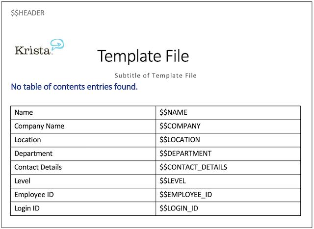
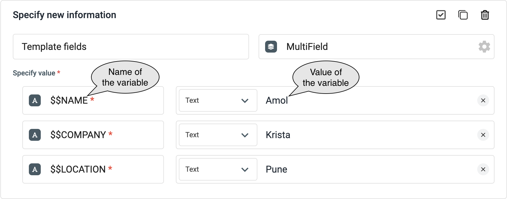
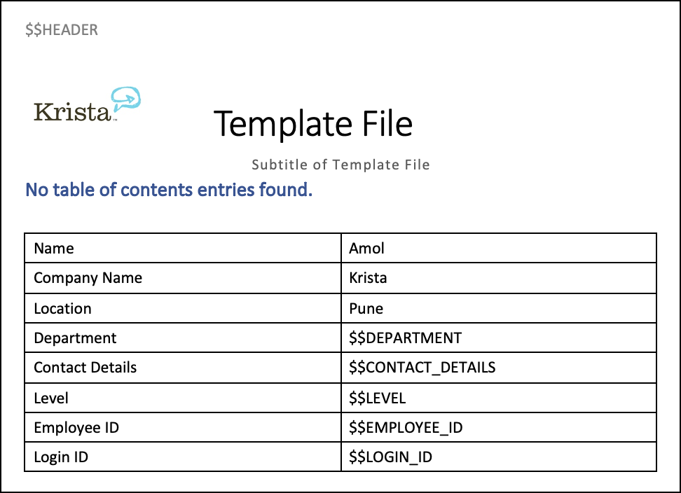

# Fill The Docx Template

## Overview

Fills a Word document template with provided data and converts it to PDF. This request takes a .docx template file with
placeholders (e.g., `$$VARIABLE`) and replaces them with values from the provided template fields.

## Request Details

- **Area**: PDF
- **Type**: CHANGE_SYSTEM
- **Retry Support**: ✅ Yes - When Allow Retry is enabled, provides comprehensive validation with user prompts for
  invalid file formats or missing template fields

## Input Parameters

| Parameter Name  | Type                   | Required | Description                                                                | Example                                                |
|-----------------|------------------------|----------|----------------------------------------------------------------------------|--------------------------------------------------------|
| Template File   | File                   | Yes      | The Word document template file with placeholders. Must be in .docx format | `invoice_template.docx`                                |
| Template Fields | Multi Field (FreeForm) | Yes      | Key-value pairs where keys match placeholders in the template              | `{customerName: "John Doe", invoiceNumber: "INV-001"}` |

### Parameter Details

#### Template File

- **Supported Formats**: `.docx`
- **Placeholder Format**: Use `$$VARIABLE` syntax in the template (e.g., `$$customerName`, `$$invoiceNumber`)
- **Validation**: File format is validated when Allow Retry is enabled
- **Template Structure**: All placeholders in the template must have corresponding values in Template Fields

#### Template Fields

- **Format**: Key-value pairs (FreeForm/Multi Field)
- **Keys**: Must match placeholder names in the template (without the `$$` prefix)
- **Values**: Text values to replace placeholders
- **Required**: All placeholders in the template must have corresponding field values

### Sample Template


*Figure 1: Sample Word template showing variable placeholders in $VARIABLE format*

**Template Placeholders Example**:

- `$$customerName` - Customer's full name
- `$$invoiceNumber` - Invoice number
- `$$date` - Invoice date
- `$$amount` - Invoice amount

### Template Fields Input Example


*Figure 2: Template fields input showing how to map values to template variables*

## Output Parameters

| Parameter Name         | Type | Description                                           |
|------------------------|------|-------------------------------------------------------|
| Docx Template PDF File | File | The generated PDF file with template fields filled in |

### Sample Output


*Figure 3: Sample output PDF showing the template with all variables replaced by actual values*

## Validation Rules

**When Allow Retry = true**

| Validation                         | Error Message                                                                                         | Resolution                                            |
|------------------------------------|-------------------------------------------------------------------------------------------------------|-------------------------------------------------------|
| Template file format must be .docx | "The provided file '[filename]' is not a valid Word document format. Only .docx files are supported." | Upload a valid Word template in .docx format          |
| Template file must not be null     | "No template file provided"                                                                           | Upload a valid template file                          |
| Template fields must be provided   | "Template fields are required"                                                                        | Provide key-value pairs for all template placeholders |

**When Allow Retry = false**

No validation is performed. Invalid inputs will result in LOGIC_ERROR or SYSTEM_ERROR.

## Error Handling

### Input Errors (INPUT_ERROR)

**When Allow Retry is enabled**

#### Invalid Template File Format

- **Cause**: The uploaded file is not in .docx format
- **Error Message**: "The provided file '[filename]' is not a valid Word document format. Only .docx files are
  supported."
- **Resolution**:
    1. Verify the file has a .docx extension
    2. Upload a valid Word template in .docx format
    3. Ensure the template contains placeholders in `$$VARIABLE` format

#### Missing Template File

- **Cause**: No template file was provided
- **Error Message**: "No template file provided"
- **Resolution**: Upload a valid Word template file

### Logic Errors (LOGIC_ERROR)

**When template processing fails**

#### Missing Template Fields

- **Cause**: Required template fields are not provided or are incomplete
- **Error Message**: "Failed to fill docx template: Template fields are required"
- **Resolution**:
    1. Ensure all placeholders in the template have corresponding field values
    2. Verify field names match placeholder names (without `$$` prefix)
    3. Check that Template Fields parameter is not empty

#### Template Processing Failure

- **Cause**: Error during template filling or conversion
- **Error Message**: "Failed to fill docx template: [error details]"
- **Common Scenarios**:
    - Placeholder mismatch (field name doesn't match placeholder)
    - Corrupted template file
    - Invalid template structure
    - Missing required fields
- **Resolution**:
    1. Verify all placeholders have corresponding field values
    2. Check template file is not corrupted
    3. Ensure placeholder syntax is correct (`$$VARIABLE`)
    4. Review error details for specific issues

### System Errors (SYSTEM_ERROR)

**When Allow Retry is disabled or for unexpected errors**

#### File Processing Failure

- **Cause**: Error during file download, processing, or upload
- **Error Message**: "Failed to fill docx template: [error details]"
- **Resolution**:
    1. Verify the template file is not corrupted
    2. Check system logs for detailed error information
    3. Ensure sufficient system resources are available
    4. Validate template structure and placeholders

## Usage Examples

### Example 1: Fill Invoice Template

**Scenario**: Generate an invoice PDF from a template

**Input**:

```
Template File: "invoice_template.docx"
Template Fields: {
  "customerName": "Acme Corporation",
  "invoiceNumber": "INV-2024-001",
  "date": "2024-01-15",
  "amount": "$5,000.00",
  "description": "Consulting Services"
}
```

**Output**:

```
Docx Template PDF File: "invoice_template.pdf"
```

**Result**: PDF invoice with all placeholders replaced with actual values.

### Example 2: Fill Contract Template

**Scenario**: Generate a contract PDF with client information

**Input**:

```
Template File: "contract_template.docx"
Template Fields: {
  "clientName": "John Smith",
  "companyName": "Smith Industries",
  "startDate": "March 1, 2024",
  "endDate": "February 28, 2025",
  "contractValue": "$50,000"
}
```

**Output**:

```
Docx Template PDF File: "contract_template.pdf"
```

**Result**: PDF contract with all client information filled in.

### Example 3: Retry Scenario (Allow Retry Enabled)

**Scenario**: User provides invalid file format, then corrects it

**Interaction**:

```
User: "Fill this template with customer data"
File: "template.txt"

System: "The provided file 'template.txt' is not a valid Word document format. Only .docx files are supported."
Prompt: "Please upload a valid Microsoft Word document (.docx file)."

User: *uploads "template.docx"*
User: *provides template fields*

System: "Success! Template filled and converted to PDF."
Output: "template.pdf"
```

## Business Rules

1. **All Placeholders Required**: All placeholders in the template must have corresponding values in Template Fields
2. **Placeholder Syntax**: Placeholders must use `$$VARIABLE` format in the template
3. **Field Name Matching**: Template field keys must match placeholder names (without the `$$` prefix)
4. **Case Sensitivity**: Placeholder names are case-sensitive
5. **Single Template Processing**: One template is processed per request
6. **Automatic PDF Conversion**: The filled template is automatically converted to PDF format

## Limitations

1. **File Format**: Only .docx template files are supported
2. **Placeholder Format**: Only `$$VARIABLE` syntax is supported for placeholders
3. **All Fields Required**: All placeholders in the template must have corresponding field values
4. **No Partial Filling**: If any placeholder is missing a value, the entire operation may fail
5. **Formatting Preservation**: Complex Word formatting may have limitations (similar to Convert Docx to PDF)
6. **No Dynamic Placeholders**: Placeholder names must be known in advance and included in Template Fields

## Best Practices

### 1. Design Clear Templates

- Use descriptive placeholder names (e.g., `$$customerName` not `$$cn`)
- Document all required placeholders
- Test templates with sample data before production use

### 2. Validate Template Fields

- Ensure all placeholders have corresponding field values
- Use exact placeholder names (case-sensitive)
- Provide default values for optional fields

### 3. Use Consistent Naming

- Follow a naming convention for placeholders (e.g., camelCase)
- Avoid special characters in placeholder names
- Keep placeholder names simple and descriptive

### 4. Test Template Filling

- Test with sample data before processing real data
- Verify all placeholders are replaced correctly
- Check PDF output for formatting issues

### 5. Handle Missing Fields Gracefully

- Provide all required fields in Template Fields parameter
- Use validation to ensure completeness before submission
- Document required vs. optional fields

## Common Use Cases

### 1. Invoice Generation

```
Scenario: Generate customer invoices from template
Action: Upload invoice template, provide customer and invoice data
Result: PDF invoice ready for distribution
```

### 2. Contract Creation

```
Scenario: Create customized contracts for clients
Action: Upload contract template, provide client details
Result: PDF contract ready for signing
```

### 3. Report Generation

```
Scenario: Generate personalized reports from template
Action: Upload report template, provide report data
Result: PDF report with customized content
```

### 4. Certificate Generation

```
Scenario: Create certificates for course completion
Action: Upload certificate template, provide participant details
Result: PDF certificate ready for distribution
```

### 5. Letter Generation

```
Scenario: Generate personalized letters from template
Action: Upload letter template, provide recipient information
Result: PDF letter ready for mailing
```

## Related Catalog Requests

- [Convert Docx File to PDF File](pages/ConvertDocxFileToPDFFile.md) - Convert Word documents without template filling
- [Get Rich Text PDF File](pages/GetRichTextPDFFile.md) - Create PDFs from rich text content
- [Get Table PDF](pages/GetTablePDF.md) - Create PDFs from tabular data

## Technical Implementation

### Helper Class

- **Class**: `FillDocxTemplateHelper`
- **Package**: `app.krista.extensions.essentials.documents.pdf.helper`
- **Validation**: Uses `ValidationOrchestrator` with `TemplateFileFormatValidator`
- **Service**: Delegates to `DocxManager.fillTheDocTemplate()`

### Telemetry Metrics

- **pdf.fillTheDocxTemplate.count**: Total number of template filling requests
- **pdf.fillTheDocxTemplate.success**: Successful template fills with duration
- **pdf.fillTheDocxTemplate.error**: Failed template fills with error details and duration

### Validation Flow

1. Validate template file format (.docx)
2. If validation passes, download template file
3. Fill template with provided fields using DocxManager
4. Convert filled template to PDF
5. Upload result and return success response
6. If validation fails, prompt user for correction (when Allow Retry enabled)

## Troubleshooting

### Issue: "Template fields are required" error

**Cause**: Template Fields parameter is missing or empty

**Solution**:

1. Provide Template Fields with key-value pairs
2. Ensure all placeholders have corresponding field values
3. Verify field names match placeholder names

### Issue: Placeholders not replaced in output

**Cause**: Field names don't match placeholder names

**Solution**:

1. Check placeholder names in template (without `$$` prefix)
2. Ensure field names in Template Fields match exactly (case-sensitive)
3. Verify placeholder syntax is `$$VARIABLE` format

### Issue: "File format not supported" error

**Cause**: Template file is not in .docx format

**Solution**:

1. Check file extension is .docx
2. Open file in Microsoft Word and save as .docx format
3. Ensure file is not corrupted

### Issue: Template filling fails with error

**Cause**: Corrupted template or invalid structure

**Solution**:

1. Open template in Microsoft Word to verify it's not corrupted
2. Check that all placeholders use correct syntax
3. Simplify template structure if complex
4. Test with a minimal template first

### Issue: Output PDF has formatting issues

**Cause**: Complex Word formatting may not be fully preserved

**Solution**:

1. Simplify template formatting
2. Use standard fonts and basic formatting
3. Test template before production use
4. Adjust template structure as needed

## See Also

- [Extension Configuration](pages/ExtensionConfiguration.md) - Configure Allow Retry flag
- [Krista PDF Templates](pages/kristaTemplates.md) - Template types and usage
- [Convert Docx File to PDF File](pages/ConvertDocxFileToPDFFile.md) - Simple Word to PDF conversion

