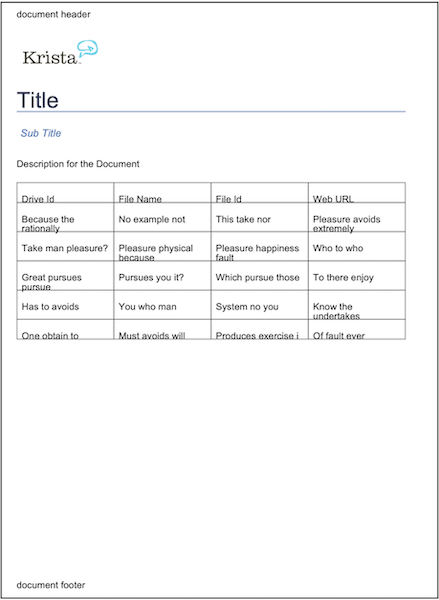

# Get Entity List PDF

## Overview

Creates a PDF file with entity values displayed in a table format. This request generates a professionally formatted PDF
with customizable title, subtitle, header, footer, logo, and entity data presented as a table.


*Figure 1: Sample entity list PDF output showing entity data in a formatted table*

## Request Details

- **Area**: PDF
- **Type**: CHANGE_SYSTEM
- **Retry Support**: ✅ Yes - When Allow Retry is enabled, provides comprehensive validation with user prompts for
  missing entity values

## Input Parameters

| Parameter Name | Type         | Required | Description                                       | Example                                              |
|----------------|--------------|----------|---------------------------------------------------|------------------------------------------------------|
| Title          | Text         | No       | Title of the PDF document                         | `Employee Directory`                                 |
| Sub Title      | Text         | No       | Subtitle of the PDF document                      | `January 2024`                                       |
| Description    | Rich Text    | No       | Description or introduction for the document      | `List of all employees...`                           |
| Header         | Text         | No       | Header text to appear on each page                | `Company Name - Confidential`                        |
| Footer         | Text         | No       | Footer text to appear on each page                | `Page {page} of {total}`                             |
| Logo           | File         | No       | Company logo or image to include in the document  | `company_logo.png`                                   |
| Entity Values  | List<Entity> | Yes      | List of entity objects to display in table format | `[{Name: "John", Age: 30}, {Name: "Jane", Age: 25}]` |

### Parameter Details

#### Entity Values (Required)

- **Format**: List of entity objects
- **Validation**: Entity values are validated when Allow Retry is enabled
- **Table Generation**: Each entity becomes a row in the table
- **Column Headers**: Entity property names become table column headers
- **Required**: This is the only mandatory parameter

#### Optional Formatting Parameters

All other parameters are optional and enhance the PDF appearance:

- **Title/Sub Title**: Appear at the top of the document
- **Header/Footer**: Appear on each page
- **Logo**: Displayed in the document header area
- **Description**: Introductory text below the title

## Output Parameters

| Parameter Name       | Type | Description                                                       |
|----------------------|------|-------------------------------------------------------------------|
| Entity List PDF File | File | The generated PDF file containing the entity data in table format |

## Validation Rules

**When Allow Retry = true**

| Validation                      | Error Message                          | Resolution                                          |
|---------------------------------|----------------------------------------|-----------------------------------------------------|
| Entity Values must be provided  | "Please provide list of Entity Values" | Provide a list of entity objects                    |
| Entity Values must not be empty | "Please provide list of Entity Values" | Ensure the entity list contains at least one entity |

**When Allow Retry = false**

No validation is performed. Invalid inputs will result in SYSTEM_ERROR.

## Error Handling

### Input Errors (INPUT_ERROR)

**When Allow Retry is enabled**

#### Missing Entity Values

- **Cause**: Entity Values parameter is not provided or is empty
- **Error Message**: "Please provide list of Entity Values"
- **Resolution**: Provide a list of entity objects with data

#### Empty Entity List

- **Cause**: Entity Values list is empty (no entities)
- **Error Message**: "Please provide list of Entity Values"
- **Resolution**: Ensure the list contains at least one entity object

### System Errors (SYSTEM_ERROR)

**When Allow Retry is disabled or for unexpected errors**

#### PDF Generation Failure

- **Cause**: Error during PDF generation or file processing
- **Error Message**: "Failed to generate entity list PDF: [error details]"
- **Common Scenarios**:
    - Invalid entity structure
    - Logo file cannot be processed
    - Insufficient memory for large entity lists
    - File upload/download issues
- **Resolution**:
    1. Verify entity structure is valid
    2. Reduce number of entities if list is very large
    3. Verify logo file is valid (if provided)
    4. Check system logs for detailed error information
    5. Ensure sufficient system resources are available

## Usage Examples

### Example 1: Employee Directory

**Scenario**: Create a PDF directory of employees

**Input**:

```
Title: "Employee Directory"
Sub Title: "Engineering Department"
Entity Values: [
  {Name: "John Smith", Role: "Engineer", Email: "john@company.com"},
  {Name: "Jane Doe", Role: "Senior Engineer", Email: "jane@company.com"},
  {Name: "Bob Johnson", Role: "Manager", Email: "bob@company.com"}
]
```

**Output**:

```
Entity List PDF File: "employee_directory.pdf"
```

**Result**: PDF with a table showing Name, Role, and Email columns.

### Example 2: Product Catalog

**Scenario**: Create a PDF catalog of products

**Input**:

```
Title: "Product Catalog"
Sub Title: "Q1 2024"
Description: "Current product offerings and pricing"
Header: "ABC Corporation"
Footer: "© 2024 ABC Corporation"
Logo: "company_logo.png"
Entity Values: [
  {Product: "Widget A", Price: "$99.99", Stock: "In Stock"},
  {Product: "Widget B", Price: "$149.99", Stock: "Limited"},
  {Product: "Widget C", Price: "$199.99", Stock: "Out of Stock"}
]
```

**Output**:

```
Entity List PDF File: "product_catalog.pdf"
```

**Result**: Professional PDF catalog with branding and product table.

### Example 3: Retry Scenario (Allow Retry Enabled)

**Scenario**: User forgets to provide entity values

**Interaction**:

```
User: "Create a PDF with employee data"
Title: "Employees"
Entity Values: (empty)

System: "Please provide list of Entity Values"
Prompt: "Enter the entity data for the table"

User: *provides entity list*

System: "Success! PDF created."
Output: "employees.pdf"
```

## Business Rules

1. **Entity Values Required**: Entity Values is the only mandatory parameter
2. **Table Format**: Entities are automatically formatted as a table
3. **Column Headers**: Entity property names become table column headers
4. **Row Data**: Each entity becomes a row in the table
5. **Optional Formatting**: All other parameters enhance appearance but are optional

## Limitations

1. **Complex Entity Fields**: Complex entity fields (like nested objects or selections) may not work correctly (known
   issue KE-1974)
2. **Rich Text in Entities**: Some rich text formatting in entity values may not be supported (known issue KE-2377)
3. **Large Entity Lists**: Very large entity lists may impact performance or cause memory issues
4. **Column Width**: Column widths are automatically calculated and may not be optimal for all data
5. **Logo Format**: Logo must be a valid image file

## Best Practices

### 1. Use Consistent Entity Structure

- Ensure all entities have the same properties
- Use descriptive property names for column headers
- Keep property names concise

### 2. Limit Entity List Size

- For large datasets, consider pagination or splitting into multiple PDFs
- Test with sample data before processing large lists
- Monitor system resources for large entity lists

### 3. Format Entity Values Appropriately

- Use simple text values in entities
- Avoid complex nested structures
- Format numbers and dates consistently

### 4. Optimize Logo Images

- Use appropriate image size and resolution
- Compress logo files for faster processing
- Use standard image formats (PNG, JPG)

### 5. Provide Meaningful Headers

- Use descriptive titles and subtitles
- Include relevant context in description
- Add page numbers in footer for multi-page tables

## Common Use Cases

### 1. Employee Directory

```
Scenario: Create PDF directory of employees
Action: Provide employee entities with name, role, contact info
Result: Professional employee directory PDF
```

### 2. Product Catalog

```
Scenario: Generate product catalog
Action: Provide product entities with name, price, availability
Result: Formatted product catalog PDF
```

### 3. Contact List

```
Scenario: Create contact list PDF
Action: Provide contact entities with name, phone, email
Result: Organized contact list PDF
```

### 4. Inventory Report

```
Scenario: Generate inventory report
Action: Provide inventory entities with item, quantity, location
Result: Inventory report in table format
```

### 5. Student Roster

```
Scenario: Create student roster
Action: Provide student entities with name, ID, grade
Result: Student roster PDF
```

## Related Catalog Requests

- [Get Table PDF](pages/GetTablePDF.md) - Create PDFs from multi-field table data
- [Get Rich Text PDF File](pages/GetRichTextPDFFile.md) - Create PDFs from rich text content
- [Convert Excel to PDF](pages/ConvertExcelToPDF.md) - Convert Excel data to PDF

## Technical Implementation

### Helper Class

- **Class**: Implemented directly in `PDFArea` class
- **Package**: `app.krista.extensions.essentials.documents.pdf.catalog`
- **Validation**: Validates entity values are provided and not empty
- **Service**: Delegates to `PDFManager.getEntityListPdf()`

### Telemetry Metrics

- **pdf.getEntityListPDF.count**: Total number of PDF generation requests
- **pdf.getEntityListPDF.success**: Successful generations with duration
- **pdf.getEntityListPDF.error**: Failed generations with error details and duration

### Validation Flow

1. Validate Entity Values are provided and not empty
2. If logo provided, download and validate logo file
3. Generate PDF table using PDFManager with all parameters
4. Upload result and return success response
5. If validation fails, prompt user for correction (when Allow Retry enabled)

## Troubleshooting

### Issue: "Please provide list of Entity Values" error

**Cause**: Entity Values parameter is missing or empty

**Solution**:

1. Provide a list of entity objects
2. Ensure list contains at least one entity
3. Verify entity structure is valid

### Issue: Table columns are too narrow/wide

**Cause**: Automatic column width calculation may not be optimal

**Solution**:

1. Use shorter property names for narrower columns
2. Reduce number of columns if possible
3. Consider landscape orientation for wide tables

### Issue: Complex entity fields not working

**Cause**: Known limitation with complex fields (KE-1974)

**Solution**:

1. Use simple text values in entities
2. Flatten nested structures before creating PDF
3. Convert complex fields to simple text representations

### Issue: Rich text in entities not displaying correctly

**Cause**: Known limitation with rich text in entity values (KE-2377)

**Solution**:

1. Use plain text in entity values
2. Remove rich text formatting
3. Use [Get Rich Text PDF File](pages/GetRichTextPDFFile.md) for rich text content

### Issue: Logo not appearing in PDF

**Cause**: Logo file may be invalid or too large

**Solution**:

1. Verify logo file is a valid image
2. Reduce logo file size
3. Use standard image format (PNG, JPG)
4. Try generating without logo first

### Issue: Large entity list causes timeout

**Cause**: Too many entities to process in one request

**Solution**:

1. Reduce number of entities
2. Split into multiple PDFs
3. Increase timeout settings if possible
4. Simplify entity structure

## See Also

- [Extension Configuration](pages/ExtensionConfiguration.md) - Configure Allow Retry flag
- [Krista PDF Templates](pages/kristaTemplates.md) - Template types and usage
- [Get Table PDF](pages/GetTablePDF.md) - Alternative table-based PDF generation
- [Release Notes](pages/release-notes.md) - Known issues with entity list PDFs

