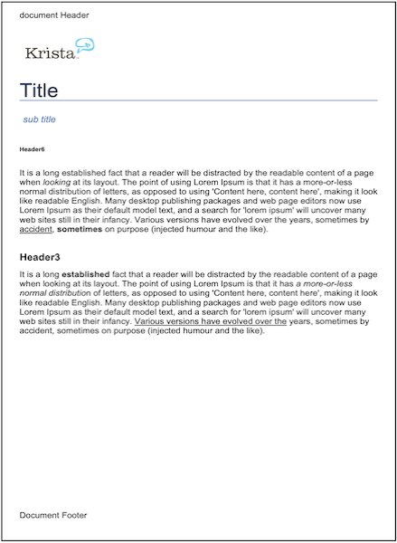

# Get Rich Text PDF File

## Overview

Creates a PDF file from rich text content using the Krista template format. This request generates a professionally
formatted PDF with customizable title, subtitle, header, footer, logo, and rich text content.


*Figure 1: Sample rich text PDF output with title, header, footer, and formatted content*

## Request Details

- **Area**: PDF
- **Type**: CHANGE_SYSTEM
- **Retry Support**: ✅ Yes - When Allow Retry is enabled, provides comprehensive validation with user prompts for
  invalid rich text format

## Input Parameters

| Parameter Name | Type      | Required | Description                                          | Example                              |
|----------------|-----------|----------|------------------------------------------------------|--------------------------------------|
| Title          | Text      | No       | Title of the PDF document                            | `Monthly Report`                     |
| Sub Title      | Text      | No       | Subtitle of the PDF document                         | `January 2024`                       |
| Description    | Rich Text | No       | Description or introduction for the document         | `This report summarizes...`          |
| Header         | Text      | No       | Header text to appear on each page                   | `Company Name - Confidential`        |
| Footer         | Text      | No       | Footer text to appear on each page                   | `Page {page} of {total}`             |
| Logo           | File      | No       | Company logo or image to include in the document     | `company_logo.png`                   |
| Rich Text Data | Rich Text | Yes      | The main rich text content to be included in the PDF | `<p>This is the main content...</p>` |

### Parameter Details

#### Rich Text Data (Required)

- **Format**: HTML-formatted rich text
- **Validation**: Rich text format and content are validated when Allow Retry is enabled
- **Supported Elements**: Paragraphs, headings, bold, italic, underline, lists, hyperlinks
- **Required**: This is the only mandatory parameter

#### Optional Formatting Parameters

All other parameters are optional and enhance the PDF appearance:

- **Title/Sub Title**: Appear at the top of the document
- **Header/Footer**: Appear on each page
- **Logo**: Displayed in the document header area
- **Description**: Introductory text below the title

## Output Parameters

| Parameter Name    | Type | Description                                                       |
|-------------------|------|-------------------------------------------------------------------|
| RichText PDF File | File | The generated PDF file containing the formatted rich text content |

## Validation Rules

**When Allow Retry = true**

| Validation                      | Error Message                   | Resolution                                  |
|---------------------------------|---------------------------------|---------------------------------------------|
| Rich Text Data must be provided | "Please provide Rich Text Data" | Provide rich text content for the PDF       |
| Rich Text format must be valid  | "Invalid Rich Text format"      | Ensure rich text is properly formatted HTML |

**When Allow Retry = false**

No validation is performed. Invalid inputs will result in SYSTEM_ERROR.

## Error Handling

### Input Errors (INPUT_ERROR)

**When Allow Retry is enabled**

#### Missing Rich Text Data

- **Cause**: Rich Text Data parameter is not provided or is empty
- **Error Message**: "Please provide Rich Text Data"
- **Resolution**: Provide rich text content for the PDF document

#### Invalid Rich Text Format

- **Cause**: Rich text content has invalid HTML formatting
- **Error Message**: "Invalid Rich Text format"
- **Resolution**:
    1. Verify rich text is properly formatted HTML
    2. Check for unclosed tags or invalid HTML
    3. Use a rich text editor to generate valid content

### System Errors (SYSTEM_ERROR)

**When Allow Retry is disabled or for unexpected errors**

#### PDF Generation Failure

- **Cause**: Error during PDF generation or file processing
- **Error Message**: "Failed to generate rich text PDF: [error details]"
- **Common Scenarios**:
    - Invalid HTML in rich text
    - Logo file cannot be processed
    - Insufficient memory
    - File upload/download issues
- **Resolution**:
    1. Simplify rich text content
    2. Verify logo file is valid (if provided)
    3. Check system logs for detailed error information
    4. Ensure sufficient system resources are available

## Usage Examples

### Example 1: Simple Rich Text PDF

**Scenario**: Create a PDF with basic rich text content

**Input**:

```
Title: "Meeting Notes"
Sub Title: "Team Sync - January 15, 2024"
Rich Text Data: "<h2>Agenda</h2><ul><li>Project updates</li><li>Q1 planning</li></ul>"
```

**Output**:

```
RichText PDF File: "meeting_notes.pdf"
```

**Result**: PDF with formatted meeting notes.

### Example 2: Formatted Report with Logo

**Scenario**: Create a professional report with company branding

**Input**:

```
Title: "Quarterly Business Review"
Sub Title: "Q4 2023"
Description: "This report provides an overview of Q4 performance and key metrics."
Header: "ABC Corporation - Confidential"
Footer: "© 2024 ABC Corporation"
Logo: "company_logo.png"
Rich Text Data: "<h2>Executive Summary</h2><p>Revenue increased by 15%...</p>"
```

**Output**:

```
RichText PDF File: "quarterly_review.pdf"
```

**Result**: Professional PDF report with branding and formatted content.

### Example 3: Retry Scenario (Allow Retry Enabled)

**Scenario**: User forgets to provide rich text data

**Interaction**:

```
User: "Create a PDF report"
Title: "Report"
Rich Text Data: (empty)

System: "Please provide Rich Text Data"
Prompt: "Enter the rich text content for the PDF"

User: *provides rich text content*

System: "Success! PDF created."
Output: "report.pdf"
```

## Business Rules

1. **Rich Text Data Required**: Rich Text Data is the only mandatory parameter
2. **Optional Formatting**: All other parameters enhance appearance but are optional
3. **HTML Format**: Rich text must be valid HTML
4. **Logo Optional**: Logo file is optional; PDF can be generated without it
5. **Page Formatting**: Header and footer appear on all pages if provided

## Limitations

1. **Rich Text Format**: Only HTML-formatted rich text is supported
2. **Supported HTML Elements**: Limited to basic HTML elements (paragraphs, headings, lists, links, basic formatting)
3. **Complex HTML**: Advanced HTML/CSS features may not be supported
4. **Logo Format**: Logo must be a valid image file
5. **Bullet Lists**: Some bullet list formatting may not display perfectly (known issue KE-2377)
6. **Hyperlinks**: Hyperlink formatting may have limitations (known issue KR-18687)

## Best Practices

### 1. Use Valid HTML

- Generate rich text using a rich text editor
- Ensure all HTML tags are properly closed
- Use standard HTML elements

### 2. Keep Content Simple

- Use basic formatting (bold, italic, lists)
- Avoid complex HTML/CSS
- Test with simple content first

### 3. Optimize Logo Images

- Use appropriate image size and resolution
- Compress logo files for faster processing
- Use standard image formats (PNG, JPG)

### 4. Provide Meaningful Headers/Footers

- Include page numbers in footer if needed
- Add confidentiality notices in header
- Keep header/footer text concise

### 5. Test Rich Text Rendering

- Preview rich text before generating PDF
- Test with sample content
- Verify formatting appears as expected

## Common Use Cases

### 1. Meeting Notes

```
Scenario: Create PDF from meeting notes
Action: Provide title, date, and formatted notes as rich text
Result: Professional meeting notes PDF
```

### 2. Report Generation

```
Scenario: Generate formatted business reports
Action: Provide report title, branding, and rich text content
Result: Branded PDF report
```

### 3. Documentation

```
Scenario: Create technical documentation PDFs
Action: Provide documentation content with headings and lists
Result: Formatted documentation PDF
```

### 4. Announcements

```
Scenario: Create company announcements
Action: Provide announcement title and formatted content
Result: Professional announcement PDF
```

## Related Catalog Requests

- [Get Entity List PDF](pages/GetEntityListPDF.md) - Create PDFs from entity data in table format
- [Get Table PDF](pages/GetTablePDF.md) - Create PDFs from tabular data
- [Fill The Docx Template](pages/FillTheDocxTemplate.md) - Fill templates with data

## Technical Implementation

### Helper Class

- **Class**: `RichTextPdfHelper`
- **Package**: `app.krista.extensions.essentials.documents.pdf.helper`
- **Validation**: Uses `ValidationOrchestrator` with `RichTextValidator`
- **Service**: Delegates to `PDFManager.getRichTextPdf()`

### Telemetry Metrics

- **pdf.getRichTextPDFFile.count**: Total number of PDF generation requests
- **pdf.getRichTextPDF.success**: Successful generations with duration
- **pdf.getRichTextPDF.error**: Failed generations with error details and duration

### Validation Flow

1. Validate Rich Text Data is provided and valid
2. If logo provided, download and validate logo file
3. Generate PDF using PDFManager with all parameters
4. Upload result and return success response
5. If validation fails, prompt user for correction (when Allow Retry enabled)

## Troubleshooting

### Issue: "Please provide Rich Text Data" error

**Cause**: Rich Text Data parameter is missing or empty

**Solution**:

1. Provide rich text content
2. Ensure content is not empty
3. Use a rich text editor to generate content

### Issue: "Invalid Rich Text format" error

**Cause**: Rich text contains invalid HTML

**Solution**:

1. Check for unclosed HTML tags
2. Use a rich text editor to generate valid HTML
3. Simplify HTML structure
4. Remove unsupported HTML elements

### Issue: Bullet lists not displaying correctly

**Cause**: Known limitation with bullet list rendering (KE-2377)

**Solution**:

1. Use simple list formatting
2. Consider using numbered lists instead
3. Test with different list styles

### Issue: Hyperlinks not displaying correctly

**Cause**: Known limitation with hyperlink formatting (KR-18687)

**Solution**:

1. Use simple hyperlink format
2. Test hyperlinks in generated PDF
3. Consider displaying URLs as plain text

### Issue: Logo not appearing in PDF

**Cause**: Logo file may be invalid or too large

**Solution**:

1. Verify logo file is a valid image
2. Reduce logo file size
3. Use standard image format (PNG, JPG)
4. Try generating without logo first

## See Also

- [Extension Configuration](pages/ExtensionConfiguration.md) - Configure Allow Retry flag
- [Krista PDF Templates](pages/kristaTemplates.md) - Template types and usage
- [Get Entity List PDF](pages/GetEntityListPDF.md) - Table-based PDF generation
- [Release Notes](pages/release-notes.md) - Known issues with rich text rendering

