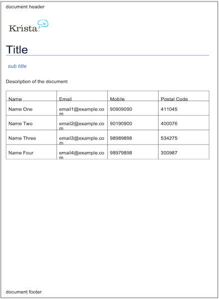

# Get Table PDF

## Overview

Creates a PDF file with multi-field values displayed in a tabular format. This request generates a professionally
formatted PDF with customizable title, subtitle, header, footer, logo, and table data.


*Figure 1: Sample table PDF output showing multi-field data in a formatted table*

## Request Details

- **Area**: PDF
- **Type**: CHANGE_SYSTEM
- **Retry Support**: ✅ Yes - When Allow Retry is enabled, provides comprehensive validation with user prompts for
  missing table data

## Input Parameters

| Parameter Name | Type              | Required | Description                                            | Example                                                    |
|----------------|-------------------|----------|--------------------------------------------------------|------------------------------------------------------------|
| Title          | Text              | No       | Title of the PDF document                              | `Sales Report`                                             |
| Sub Title      | Text              | No       | Subtitle of the PDF document                           | `Q1 2024`                                                  |
| Description    | Rich Text         | No       | Description or introduction for the document           | `Quarterly sales summary...`                               |
| Header         | Text              | No       | Header text to appear on each page                     | `Company Name - Confidential`                              |
| Footer         | Text              | No       | Footer text to appear on each page                     | `Page {page} of {total}`                                   |
| Logo           | File              | No       | Company logo or image to include in the document       | `company_logo.png`                                         |
| Table Data     | List<Multi Field> | Yes      | List of multi-field objects to display in table format | `[{Product: "A", Sales: 100}, {Product: "B", Sales: 150}]` |

### Parameter Details

#### Table Data (Required)

- **Format**: List of multi-field objects
- **Validation**: Table data is validated when Allow Retry is enabled
- **Table Generation**: Each multi-field object becomes a row in the table
- **Column Headers**: Field names become table column headers
- **Required**: This is the only mandatory parameter

#### Optional Formatting Parameters

All other parameters are optional and enhance the PDF appearance:

- **Title/Sub Title**: Appear at the top of the document
- **Header/Footer**: Appear on each page
- **Logo**: Displayed in the document header area
- **Description**: Introductory text below the title

## Output Parameters

| Parameter Name | Type | Description                                      |
|----------------|------|--------------------------------------------------|
| Table PDF File | File | The generated PDF file containing the table data |

## Validation Rules

**When Allow Retry = true**

| Validation                   | Error Message               | Resolution                                           |
|------------------------------|-----------------------------|------------------------------------------------------|
| Table Data must be provided  | "Please provide Table Data" | Provide a list of multi-field objects                |
| Table Data must not be empty | "Please provide Table Data" | Ensure the table data list contains at least one row |

**When Allow Retry = false**

No validation is performed. Invalid inputs will result in SYSTEM_ERROR.

## Error Handling

### Input Errors (INPUT_ERROR)

**When Allow Retry is enabled**

#### Missing Table Data

- **Cause**: Table Data parameter is not provided or is empty
- **Error Message**: "Please provide Table Data"
- **Resolution**: Provide a list of multi-field objects with data

#### Empty Table Data List

- **Cause**: Table Data list is empty (no rows)
- **Error Message**: "Please provide Table Data"
- **Resolution**: Ensure the list contains at least one multi-field object

### System Errors (SYSTEM_ERROR)

**When Allow Retry is disabled or for unexpected errors**

#### PDF Generation Failure

- **Cause**: Error during PDF generation or file processing
- **Error Message**: "Failed to generate table PDF: [error details]"
- **Common Scenarios**:
    - Invalid table data structure
    - Logo file cannot be processed
    - Insufficient memory for large tables
    - File upload/download issues
- **Resolution**:
    1. Verify table data structure is valid
    2. Reduce number of rows if table is very large
    3. Verify logo file is valid (if provided)
    4. Check system logs for detailed error information
    5. Ensure sufficient system resources are available

## Usage Examples

### Example 1: Sales Report

**Scenario**: Create a PDF sales report with product data

**Input**:

```
Title: "Sales Report"
Sub Title: "Q1 2024"
Table Data: [
  {Product: "Widget A", Units: 150, Revenue: "$14,985"},
  {Product: "Widget B", Units: 200, Revenue: "$29,980"},
  {Product: "Widget C", Units: 100, Revenue: "$19,990"}
]
```

**Output**:

```
Table PDF File: "sales_report.pdf"
```

**Result**: PDF with a table showing Product, Units, and Revenue columns.

### Example 2: Attendance Report with Branding

**Scenario**: Create a branded attendance report

**Input**:

```
Title: "Attendance Report"
Sub Title: "January 2024"
Description: "Monthly attendance summary for all employees"
Header: "HR Department - Confidential"
Footer: "© 2024 Company Name"
Logo: "company_logo.png"
Table Data: [
  {Employee: "John Smith", Days Present: 20, Days Absent: 2},
  {Employee: "Jane Doe", Days Present: 22, Days Absent: 0},
  {Employee: "Bob Johnson", Days Present: 19, Days Absent: 3}
]
```

**Output**:

```
Table PDF File: "attendance_report.pdf"
```

**Result**: Professional PDF report with branding and attendance table.

### Example 3: Retry Scenario (Allow Retry Enabled)

**Scenario**: User forgets to provide table data

**Interaction**:

```
User: "Create a PDF with sales data"
Title: "Sales Report"
Table Data: (empty)

System: "Please provide Table Data"
Prompt: "Enter the table data for the PDF"

User: *provides table data*

System: "Success! PDF created."
Output: "sales_report.pdf"
```

## Business Rules

1. **Table Data Required**: Table Data is the only mandatory parameter
2. **Table Format**: Multi-field objects are automatically formatted as a table
3. **Column Headers**: Field names become table column headers
4. **Row Data**: Each multi-field object becomes a row in the table
5. **Optional Formatting**: All other parameters enhance appearance but are optional
6. **Logo Optional**: Logo file is optional; PDF can be generated without it (fixed in KE-2001)

## Limitations

1. **Large Tables**: Very large tables may impact performance or cause memory issues
2. **Column Width**: Column widths are automatically calculated and may not be optimal for all data
3. **Complex Field Types**: Complex nested structures may not be supported
4. **Logo Format**: Logo must be a valid image file
5. **Page Breaks**: Long tables automatically span multiple pages

## Best Practices

### 1. Use Consistent Field Structure

- Ensure all multi-field objects have the same fields
- Use descriptive field names for column headers
- Keep field names concise

### 2. Limit Table Size

- For large datasets, consider pagination or splitting into multiple PDFs
- Test with sample data before processing large tables
- Monitor system resources for large tables

### 3. Format Field Values Appropriately

- Use simple text values in fields
- Format numbers and dates consistently
- Avoid complex nested structures

### 4. Optimize Logo Images

- Use appropriate image size and resolution
- Compress logo files for faster processing
- Use standard image formats (PNG, JPG)

### 5. Provide Meaningful Headers

- Use descriptive titles and subtitles
- Include relevant context in description
- Add page numbers in footer for multi-page tables

## Common Use Cases

### 1. Sales Reports

```
Scenario: Create PDF sales reports with product data
Action: Provide table data with products, quantities, and revenue
Result: Professional sales report PDF
```

### 2. Attendance Tracking

```
Scenario: Generate attendance reports
Action: Provide table data with employee names and attendance
Result: Formatted attendance report PDF
```

### 3. Inventory Lists

```
Scenario: Create inventory lists
Action: Provide table data with items, quantities, and locations
Result: Inventory list PDF
```

### 4. Financial Summaries

```
Scenario: Generate financial summaries
Action: Provide table data with accounts and balances
Result: Financial summary PDF
```

### 5. Project Status Reports

```
Scenario: Create project status reports
Action: Provide table data with tasks, status, and owners
Result: Project status report PDF
```

## Related Catalog Requests

- [Get Entity List PDF](pages/GetEntityListPDF.md) - Create PDFs from entity data (similar functionality)
- [Get Rich Text PDF File](pages/GetRichTextPDFFile.md) - Create PDFs from rich text content
- [Convert Excel to PDF](pages/ConvertExcelToPDF.md) - Convert Excel data to PDF

## Technical Implementation

### Helper Class

- **Class**: `TableDataPdfHelper`
- **Package**: `app.krista.extensions.essentials.documents.pdf.helper`
- **Validation**: Validates table data is provided and not empty
- **Service**: Delegates to `PDFManager.getTableDataPdf()`

### Telemetry Metrics

- **pdf.getTableDataPDF.count**: Total number of PDF generation requests
- **pdf.getTableDataPDF.success**: Successful generations with duration
- **pdf.getTableDataPDF.error**: Failed generations with error details and duration

### Validation Flow

1. Validate Table Data is provided and not empty
2. If logo provided, download and validate logo file
3. Generate PDF table using PDFManager with all parameters
4. Upload result and return success response
5. If validation fails, prompt user for correction (when Allow Retry enabled)

## Troubleshooting

### Issue: "Please provide Table Data" error

**Cause**: Table Data parameter is missing or empty

**Solution**:

1. Provide a list of multi-field objects
2. Ensure list contains at least one row
3. Verify table data structure is valid

### Issue: "Request not working without logo file" error

**Cause**: This was a known issue (KE-2001) that has been resolved

**Solution**:

1. Ensure you're using extension version 2.0.7 or later
2. Logo file is now optional
3. PDF can be generated without providing a logo

### Issue: Table columns are too narrow/wide

**Cause**: Automatic column width calculation may not be optimal

**Solution**:

1. Use shorter field names for narrower columns
2. Reduce number of columns if possible
3. Consider landscape orientation for wide tables

### Issue: Logo not appearing in PDF

**Cause**: Logo file may be invalid or too large

**Solution**:

1. Verify logo file is a valid image
2. Reduce logo file size
3. Use standard image format (PNG, JPG)
4. Try generating without logo (logo is optional)

### Issue: Large table causes timeout

**Cause**: Too many rows to process in one request

**Solution**:

1. Reduce number of rows
2. Split into multiple PDFs
3. Increase timeout settings if possible
4. Simplify table structure

### Issue: Table formatting issues

**Cause**: Complex field values or structure

**Solution**:

1. Use simple text values in fields
2. Avoid nested structures
3. Format values consistently
4. Test with simplified data

## See Also

- [Extension Configuration](pages/ExtensionConfiguration.md) - Configure Allow Retry flag
- [Krista PDF Templates](pages/kristaTemplates.md) - Template types and usage
- [Get Entity List PDF](pages/GetEntityListPDF.md) - Alternative entity-based PDF generation
- [Release Notes](pages/release-notes.md) - Known issues and fixes

