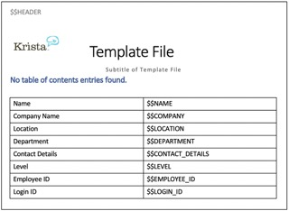
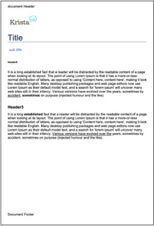
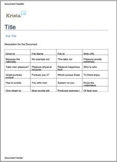
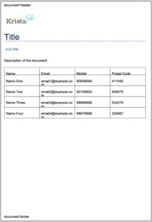

# Krista Templates

## Overview

The PDF Extension provides two types of templates for generating professional PDF documents:

1. **Custom Template** - Fill Word templates with dynamic data
2. **Krista PDF Templates** - Generate PDFs with structured data using built-in templates

---

## Sample Template

### Description

This template is used to create custom format PDF files by filling Word document templates with dynamic data.

### Template Type: Fill The Docx Template

|  **Sample Docx File** Fill Word templates with dynamic data and generate PDF [Learn more about Fill The Docx Template](pages/FillTheDocxTemplate.md) To download sample template, click <a href="docs/_media/Sample_Template.docx" type="application/vnd.openxmlformats-officedocument.wordprocessingml.document" download="Sample_Template.docx">here</a> |
|----------------------------------------------------------------------------------------------------------------------------------------------------------------------------------------------------------------------------------------------------------------------------------------------------------------------------------------------------------------------------------------------------------------------------------------------------------------------------------------|

**Key Features:**

- Use `$VARIABLE` syntax for placeholders
- All template variables must be provided
- Generates PDF with filled data
- Supports text, numbers, and dates

---

## Krista PDF Templates

### Description

These templates take Title, Subtitle, Header, Footer, Description, and Logo as input and generate professionally
formatted PDF files with structured data.

### Available Templates

|  **Rich Text Document** Create PDFs from rich text content with HTML formatting [Learn more about Get Rich Text PDF File](pages/GetRichTextPDFFile.md) |  **Entity List Document** Create PDFs with entity data in table format [Learn more about Get Entity List PDF](pages/GetEntityListPDF.md) |  **Table Data Document** Create PDFs with multi-field data in tabular format [Learn more about Get Table PDF](pages/GetTablePDF.md) |
|-----------------------------------------------------------------------------------------------------------------------------------------------------------------------------------------------------------------------------------------------------|---------------------------------------------------------------------------------------------------------------------------------------------------------------------------------------------------------------------------------------|-----------------------------------------------------------------------------------------------------------------------------------------------------------------------------------------------------------------------|

**Common Features:**

- Professional formatting with title, subtitle, header, footer
- Optional company logo
- Customizable description
- Automatic page numbering
- Consistent branding across documents

---

## Template Selection Guide

### Use Fill The Docx Template When:

- You need custom document layouts
- You have existing Word templates
- You want full control over formatting
- You need to fill forms or contracts

### Use Rich Text PDF Template When:

- You need to convert HTML/rich text to PDF
- You want formatted text with headings and lists
- You need simple document generation
- Content is primarily text-based

### Use Entity List PDF Template When:

- You have entity data to display in tables
- You need to generate reports from database records
- You want automatic table formatting
- Data has consistent structure

### Use Table PDF Template When:

- You have multi-field data to display
- You need tabular reports
- You want automatic column headers
- Data is in structured format

---

## See Also

- [Fill The Docx Template](pages/FillTheDocxTemplate.md) - Detailed documentation for custom templates
- [Get Rich Text PDF File](pages/GetRichTextPDFFile.md) - Rich text PDF generation
- [Get Entity List PDF](pages/GetEntityListPDF.md) - Entity data table PDFs
- [Get Table PDF](pages/GetTablePDF.md) - Multi-field table PDFs
- [Extension Configuration](pages/ExtensionConfiguration.md) - Setup and configuration

